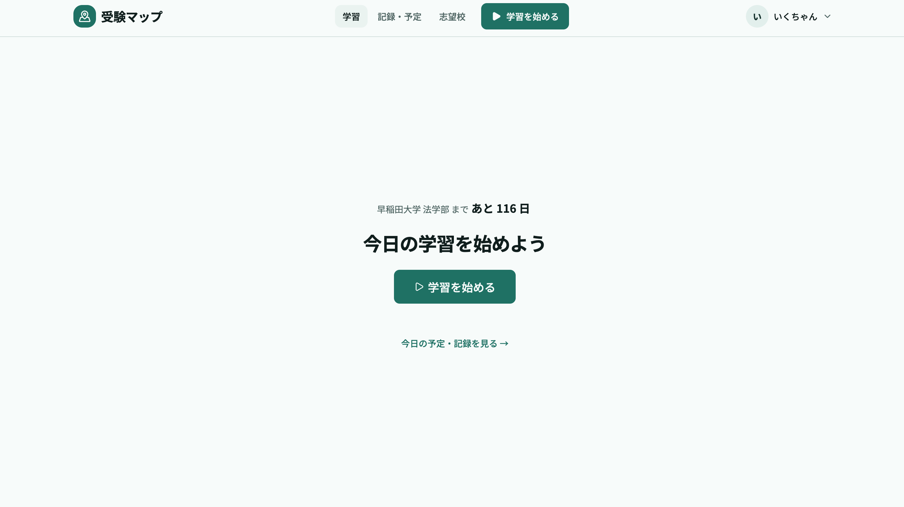
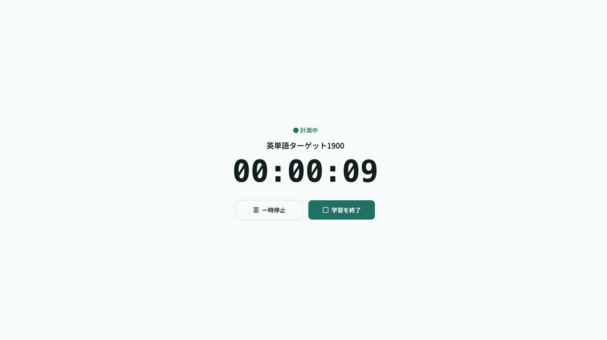

# 受験マップ

## このプロダクトの概要

受験生が勉強の進捗を管理しやすくするようなアプリ。勉強開始ボタンでタイマーがスタートして、終了ボタンを押すと、アプリ内のカレンダーにやった内容と、勉強時間が記録されるようになる。

## 工夫した点

### ① 動線

トップページを開いたら勉強開始ボタンが大きく表示されるようになっていて、アプリを開いた瞬間にすぐ勉強を開始できるようにしてある。

### ② タイマーの表示のところ

タイマー表示している画面はタイマー以外の内容を表示しないようにして、勉強に集中できるようにした。

### ③ 技術的な点

実際の実務の運用を意識した。より実務的なことも経験したかったため、作っただけではなく、Grafana で監視するなど、運用のところまで意識した。

## 大変だったところ

運用のところまで実務と同じように考えることができたが、そのプロダクトがどういったところがいいのか自分で理解しきれてなかった。なので、まずはバックエンドから、こういったDBが良くて、こういったAPIが良くてみたいなところを自分で深く理解しながらやることで、良いDBとは何かみたいなところからもう一度理解している。

## 今やっていること

特にバックエンドのところを詳しく理解しようとしている。

1. 技術的にこういったデータベースがいいなというところの理解
2. それらを踏まえて、今回のアプリにどう入れたらいいかの理解

学習のノート: [バックエンド（Notion）](https://app.notion.com/p/3d4db149348b8099b57ae5ecf74cf492)
