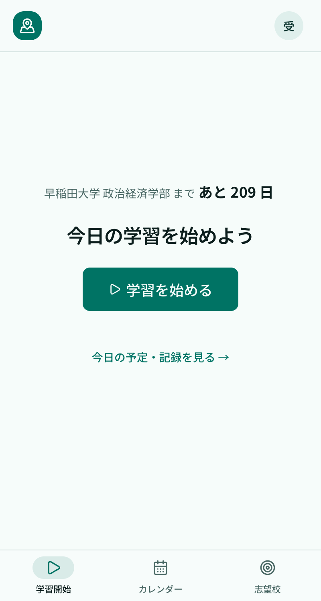
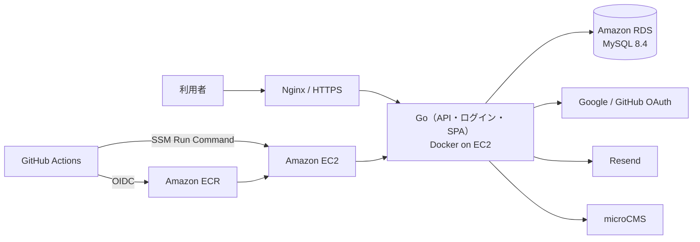

# 受験マップ

大学受験生が、毎日の学習を簡単に記録し、予定・実績・志望校まで一か所で振り返れるWebアプリです。

「記録を続けるために入力の手間を減らすこと」を中心に、学習タイマー、クイック記録、カレンダーによる可視化を実装しています。全国の大学・学部マスターを使った志望校管理や、受験日程の確認にも対応しています。

[本番環境を開く](https://juken-map.com)（AWS EC2上でセルフホスト）

## このアプリで目指していること

実際に多くの受験生に使われても、技術的に問題なく動く状態を目指しています。

1. **1日1万人・ピーク時に毎秒100リクエストを捌く** — ピーク時でも95%の応答を0.3秒以内に返し、サーバーエラー（5xx）を0.1%未満に抑えます。
2. **サーバーなどの費用を月1万円以内に収める** — そのかわり、稼働率の目標は100%ではなく99.5%（止まってよいのは月3.6時間まで）にしています。
3. **セキュリティは OWASP ASVS 5.0 を基準にする** — レベル1の要件を基準に対応を進めています。
4. **チームで開発しやすい、わかりやすいコードにする** — API は入口・ハンドラ・ストアに分け、決まりを含む書き込みは持ち主（`apps/api/internal/write/`）の1か所に集めています。読みやすさの基準を決め、それに沿って書いています。

目標は立てるだけでなく、測って確かめています。手元のDBに学習記録約1,000万行の合成データを入れて負荷試験を行い、本番は Grafana Cloud で監視しています。

## デモ

登録せずに、志望校や学習予定が入った状態を試せます。

1. [ログイン画面](https://juken-map.com/login)を開きます。
2. 「デモでログイン」を選択します。
3. 学習記録、カレンダー、志望校管理などを確認します。

デモユーザーは読み取り専用です。編集操作はサーバー側でも制限しています。

手動でログインする場合は、次のテストアカウントを使用できます。

- メールアドレス: `demo@juken-map.com`
- パスワード: `demodemo1234`

## 画面



## 主な機能

### 学習を記録する

- **学習タイマー** — 今日の予定や「その他の学習」から内容を選び、タイマーを開始できます。終了後は内容と時間を確認して、そのまま実績として保存できます。
- **クイック記録** — タイマーを使わなかった学習も、日付と時間を選んで後から追加できます。
- **学習実績の編集** — 日付、時間、科目、教材、範囲、メモを後から修正できます。
- **学習予定** — 日ごとの予定に科目、参考書、学習範囲を設定できます。ドラッグによる日付変更や完了操作にも対応しています。

### 学習を振り返る

- **学習カレンダー** — 予定と実績を同じ月間カレンダーに表示します。日ごとの学習時間を色の濃淡で、科目の内訳をバーで確認できます。
- **学習状況の可視化** — 継続日数、直近7日間の科目別学習時間、当日の進捗を表示します。
- **逆算ナビ** — 参考書の総量、目標日、到達位置から、今日取り組む範囲の目安を提示します。

### 志望校と受験日程を管理する

- **大学を探す** — 全国823大学のマスターから、大学名、都道府県、設置区分で絞り込めます。
- **志望校管理** — 気になる大学を候補として保存し、受験校へ確定できます。第一志望と併願校も分けて管理できます。
- **受験日程** — 登録した志望校の受験日をタイムラインやカレンダーで確認できます。

### その他

- **認証** — Google、GitHub、メールアドレスとパスワードに対応しています。メール確認とパスワード再設定にはResendを使用しています。
- **PWA** — スマートフォンのホーム画面やMacのDockへ追加し、単独のアプリとして起動できます。
- **ブログ** — microCMSで管理する記事を一覧・詳細ページに表示します。

## 設計上の工夫

- **入力から振り返りまでをつなぐ設計** — 学習の開始、実績保存、カレンダーへの反映を一連の流れとして扱い、記録の手間を抑えています。
- **サーバー状態の一元管理** — TanStack Queryを使い、志望校、学習予定、実績、参考書の取得・更新とキャッシュを管理しています。
- **画面とAPIの形を1つの契約から作る** — やり取りの形は [openapi/openapi.yaml](openapi/openapi.yaml) に1つだけ書き、画面のTypeScriptの型とGoの型をそこから生成しています。契約を変えて型を作り直し忘れると、CIが生成結果との差分で止めます。
- **多層防御** — 入力の検証を1か所で終わらせません。画面はUXのために `src/shared/validations` のZodで確かめてすぐに知らせ、APIは門番としてGoで改めて確かめます。重複の禁止はデータベースの一意制約で最後に受け止めます。デモユーザーの読み取り専用化も、UIのボタンを隠すのではなく、APIの入口（`apps/api/internal/httpx/router.go`）でGET・HEAD以外を403で断って担保しています。UIだけの制限は防御になりません。
- **推測ではなく計測してから直す** — 遅い箇所は`EXPLAIN ANALYZE`で実行計画を読んでから手を入れます。本番相当の36.9万行を投入した検証用スキーマでは、`(userId, date)`の複合索引で通知バッチのクエリが268ms から 1.75ms になりました（索引の可視・不可視を切り替えた前後比較の中央値）。一方で大学一覧はSQL自体が2.5msで索引の問題ではないと分かったため、手を入れていません。
- **Infrastructure as Code** — VPC、EC2、RDS、セキュリティグループ、ECR、IAMをTerraformで管理しています。
- **自動テストとデプロイ** — Vitest、Playwright、GitHub Actionsを使い、検査からAWSへのデプロイまでを自動化しています。

## アーキテクチャ



本番では、GitHub ActionsがDockerイメージをECRへpushします。デプロイ処理はSSM Run CommandでEC2上に実行し、EC2のIAMインスタンスロールを使ってイメージをpullします。SSHの22番ポートは公開していません。

本番の秘密情報（LINE・Grafana Cloud・microCMSのWebhookなど）はAWS Secrets Managerの`juken-map/production/runtime`で管理します。デプロイスクリプトがEC2のIAMインスタンスロールで取得し、コンテナ起動時だけ一時的な環境変数ファイルとして渡します。秘密値はTerraform stateやGitHub Actionsへ保存しません。

本番のDBユーザーは役割ごとに分けています。アプリはSELECT・INSERT・UPDATE・DELETEだけを許したユーザーで接続し、テーブル定義を変えられるユーザーはデプロイ時のマイグレーションにだけ使います（権限の定義は[db/db-users.ts](db/db-users.ts)）。

## テックスタック

| カテゴリ | 技術 |
|---|---|
| フロントエンド | React 19 / Vite（SPA） |
| バックエンド | Go（標準の net/http・database/sql） |
| 言語 | TypeScript（画面・開発用の DB の道具）／ Go（API） |
| UI | shadcn/ui / Tailwind CSS v4 / Motion |
| フォーム・検証 | React Hook Form / Zod |
| API の契約 | OpenAPI（openapi-typescript / oapi-codegen で型を生成） |
| サーバー状態 | TanStack Query |
| カレンダー | FullCalendar / Schedule-X |
| DB | MySQL 8.4（Go は database/sql、開発用の seed は mysql2 で SQL を直接書く。ORM は使わない） |
| 認証 | Go で自作（Argon2id・中身の無いセッション・TOTP・PKCE。`apps/api/internal/feature/auth/`）。以前は Better Auth |
| メール | Resend |
| CMS | microCMS |
| テスト | Vitest / Playwright |
| コンテナ | Docker / Docker Compose |
| インフラ | AWS EC2 / RDS / ECR / Nginx / Systems Manager |
| IaC | Terraform |
| CI/CD | GitHub Actions / AWS OIDC |

## データソース

全国大学マスターには、[ASTI アマノ技研「国内大学の位置データ」](https://amano-tec.com/)を利用しています。国立・公立・私立の823校を取り込み、住所から都道府県と設置区分を整形しています。

変換処理は `scripts/transform-universities.ts`、整形済みデータは `data/clean/universities.json` にあります。

## 手元で動かす

Node.js 24・pnpm・Go・Docker が必要です。詳しい手順と前提は[開発ガイド](docs/development.md)にあります。

```bash
git clone https://github.com/shimaiku1960/juken-map.git
cd juken-map
pnpm install --frozen-lockfile
cp .env.example .env
pnpm run db:start && pnpm run db:migrate && pnpm run db:seed
pnpm dev   # http://localhost:5173 を開き、「デモでログイン」を選ぶ
```

## ドキュメント

| 文書 | 内容 |
|---|---|
| [開発ガイド](docs/development.md) | セットアップ、worktree、合成データ、手元のGrafana、環境変数、開発コマンド、テストとCI |
| [運用ガイド](docs/operations.md) | デプロイ、本番で管理者を付ける、管理者の2段階認証、本番の可観測性 |
| [アーキテクチャ](docs/architecture.md) | 構成の判断とその理由、依存の向き、テスト、マイグレーション |
| [SLO と定常状態](docs/slo.md) | 目標の指標と、測った定常状態 |
| [起きたときの手順](docs/incident-response.md) | 乗っ取りなどが起きたときの操作 |
| [止まった・遅いときの記録と振り返り](docs/outage-response.md) | 障害の記録の書き方（記録は [docs/outages/](docs/outages/)） |
| [外部へ送っているデータ](docs/third-party-data.md) | 外部サービスごとの送信内容 |
| [API（Go）](apps/api/README.md) | Go のパッケージとファイルの一覧 |
| [負荷試験](load-tests/README.md) / [シミュレーション](sim/README.md) | k6 の負荷試験と、本番で利用を積むシミュレーター |

## 主なディレクトリ

```text
apps/
├── web/                 # 画面（React + Vite の SPA）
│   ├── src/pages/         ルートに対応する画面
│   ├── src/components/    画面部品（ui/ は shadcn/ui）
│   ├── src/hooks/         TanStack Query のサーバー状態フック
│   └── public/            favicon、PWAアイコン、manifest、robots.txt
└── api/                 # バックエンド一式（Go）。API・ログイン・画面の配信・運用のコマンド・マイグレーションの適用

src/
└── shared/              # 外部依存のない純粋関数・型・Zodスキーマ（両方のアプリから使う）

db/                      # DB の道具（開発でしか使わない Node の TS）
├── migrations/            マイグレーションの SQL（当てるのは Go の migrate）
├── seed*.ts               seed（`pnpm db:seed` など）
├── connection.ts          seed とテストが使う接続プール（mysql2）
├── db-users.ts            本番の DB ユーザーの権限の定義
└── test-db/               テスト用 DB の作成・権限つきユーザー・マイグレーション（Go の DB テストも使う）
e2e/                     # Playwright E2Eテスト
infra/nginx/             # 本番リバースプロキシ設定の記録
scripts/                 # 補助スクリプト
terraform/               # AWSインフラ定義（grafana/ は Grafana Cloud のアラート）
```

## 主要なデータモデル

- **User / AuthSession / AuthPassword / AuthIdentity / AuthToken / AuthTotp** — ログインのデータ（Go の `internal/feature/auth/` が読み書きする）
- **FinalGoal** — 志望校、第一志望、候補・受験校の状態
- **StudyPlan** — 日ごとの学習予定、科目、参考書、学習範囲
- **StudyLog** — 学習時間、到達範囲、メモ
- **Textbook / TextbookMaster** — ユーザーの参考書と参考書マスター
- **University / Faculty / Tag** — 大学、学部、学部系統タグのマスター
